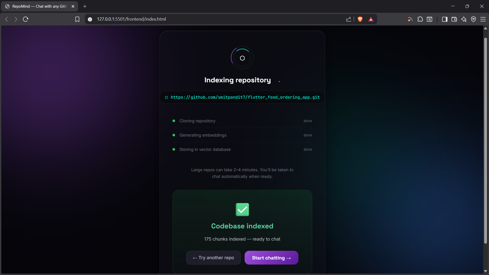
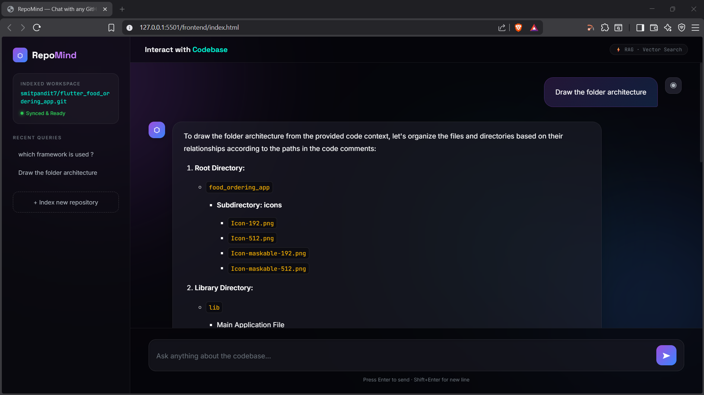

# RepoMind 🔍
### Chat with any GitHub Repository using RAG

RepoMind lets you paste any public GitHub repository URL and instantly chat with the entire codebase in natural language. It clones the repo, chunks the code intelligently at function and class boundaries, embeds it into a vector database, and uses an LLM to answer your questions with exact file and line references.

---

## Demo

> Index any GitHub repo → Ask questions → Get answers with source citations




---

## How It Works

```
GitHub URL
    ↓
Clone Repository (GitPython)
    ↓
Language-Aware Chunking (AST boundary detection)
    ↓
Generate Embeddings (Sentence Transformers)
    ↓
Store in Vector Database (ChromaDB)
    ↓
User Query
    ↓
Hybrid Retrieval (Semantic Search + File-Specific Search)
    ↓
LLM Response with Source Citations (OpenAI GPT-4o mini)
```

---

## Features

- **Language-aware chunking** — splits code at actual function and class boundaries for 30+ languages, not arbitrary line counts
- **Hybrid retrieval** — combines semantic vector search with file-specific search for maximum accuracy
- **Source citations** — every answer references exact filenames and line numbers
- **Conversation history** — maintains context across multiple questions
- **Real-time ingestion status** — live progress updates while indexing
- **Supports 30+ languages** — Python, JavaScript, TypeScript, Go, Rust, Java, Kotlin, Dart, C++, and more

---

## Tech Stack

| Layer | Technology |
|---|---|
| Backend | FastAPI, Python |
| Vector Database | ChromaDB |
| Embeddings | Sentence Transformers (`all-MiniLM-L6-v2`) |
| LLM | Ollama qwen2.5-coder:3b |
| Version Control | GitPython |
| Frontend | HTML, CSS, Vanilla JS |

---

## Project Structure

```
github-rag-agent/
├── app/
│   ├── api/
│   │   └── routes.py          # FastAPI routes
│   ├── ingestion/
│   │   └── ingestor.py        # Clone, chunk, embed, store
│   ├── query/
│   │   └── query_engine.py    # Retrieval + LLM response
│   └── shared/
│       ├── db.py              # Shared ChromaDB client
│       └── embedder.py        # Shared embedding model
├── frontend/
│   ├── index.html             # Main UI
│   ├── styles.css             # Styling
│   └── app.js                 # Frontend logic
├── main.py                    # App entry point
├── requirements.txt
└── .env                       # API keys (not committed)
```

---

## Getting Started

### Prerequisites

- Python 3.11+
- Git
- Ollama → [Get one here](https://ollama.com/)

### Installation

**1. Clone the repository:**
```bash
git clone https://gitlab.com/smitpandit2004/repomind.git
cd repomind
```

**2. Create a virtual environment:**
```bash
python -m venv venv

# Windows
venv\Scripts\activate

# Mac/Linux
source venv/bin/activate
```

**3. Install dependencies:**
```bash
pip install -r requirements.txt
```

**4. Install and setup Ollama:**
- Download Ollama from [ollama.com](https://ollama.com)
- Then pull the required model:
```bash
ollama pull qwen2.5-coder:3b
```

**5. Create `.env` file in the project root:**
```env
# No API keys required — runs fully locally via Ollama
```

**6. Run the server:**
```bash
python main.py
```

**7. Open your browser:**
```
http://localhost:8000
```

---

## Usage

1. Paste any public GitHub repository URL
2. Click **Index Repository** and wait for ingestion to complete
3. Once indexed, click **Start Chatting**
4. Ask anything about the codebase in natural language

### Example Questions
- *"Explain the main entry point logic"*
- *"How is dependency injection handled?"*
- *"Explain routes.py"*
- *"What are the critical dependencies?"*
- *"How is error handling implemented?"*
- *"Draw the folder architecture"*

---

## How Chunking Works

Most RAG systems chunk code at fixed line counts — this breaks functions in half and destroys context.

RepoMind detects language-specific boundaries using regex patterns:

```python
# Python — splits at function and class definitions
".py": re.compile(r'^\s*(def |async def |class )')

# JavaScript — splits at function declarations and exports  
".js": re.compile(r'^\s*(function |const \w+ ?= ?(async ?)?\(|class |export...)')

# Go — splits at function and type definitions
".go": re.compile(r'^\s*(func |type \w+ (struct|interface))')
```

This means each chunk is always a complete, semantically meaningful unit — a full function, a class, or a logical block.

---

## How Retrieval Works

RepoMind uses a hybrid retrieval strategy:

**If you mention a specific filename:**
```
"explain ingestor.py"
→ Fetches ALL chunks from ingestor.py
→ Adds top 2 semantic results from other files for context
```

**For general questions:**
```
"how is error handling done?"
→ Pure semantic vector search
→ Returns top-k most relevant chunks
```

This gives you complete file context when you need it, and broad codebase search when you don't.

---

## Limitations

- Only supports **public** GitHub repositories
- Large repositories (10,000+ files) may take some time to index
- Requires an active internet connection for cloning and LLM calls

---

## Roadmap

- [ ] Deploy live (public URL coming soon)
- [ ] Support private repositories
- [ ] Incremental re-indexing (only re-embed changed files)
- [ ] Multiple repository support
- [ ] Streaming LLM responses
- [ ] Docker support

---

## Author

**Smit Pandit**
- LinkedIn: [linkedin.com/in/smitpandit-bb7309247](www.linkedin.com/in/smit-pandit-bb7309247)
- GitLab: [gitlab.com/smitpandit2004](https://gitlab.com/smitpandit2004/)
- Email: panditsmit92@gmail.com

---

## License

This project is open source and available under the [MIT License](LICENSE).

---

⭐ If you found this useful, consider giving it a star!